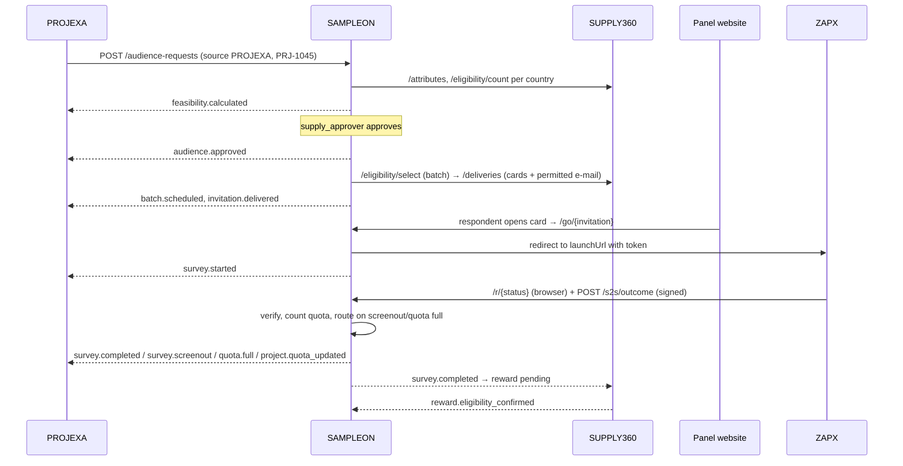

# Sampledge ecosystem architecture: SUPPLY360 · SAMPLEON · PROJEXA · ZAPX

Version 1.0 · 2026-11-06 · Owner: Kunal Sharma (Sampledge)

This is the binding integration architecture for the four Sampledge products. It extends the
SUPPLY360 development architecture (`Sampledge-full-Supply-CRM/docs/ARCHITECTURE.md`) with full,
bidirectional integration between SUPPLY360, SAMPLEON, PROJEXA and ZAPX.

**Rule.** Each responsibility has exactly one owner. No product keeps a second respondent master,
a second distribution engine, a second routing engine, a second quota service for supply, or a
second copy of a project record. Products exchange **identifiers and events**, and read each
other's data **through versioned APIs**.

---

## 1. Ownership

| Product | Role | Owns (system of record) | Must not |
|---|---|---|---|
| **SUPPLY360** | Respondent intelligence & engagement | Respondent master across the three panel websites (Turn2Opinion, MyFrequentRewards, MyHealthOpinions); demographic, B2B and healthcare profiles; verification and consent; profile-completion automation; activity and participation history; engagement and retention; e-mail, SMS and survey-card **delivery**; rewards and redemptions; respondent support; account quality; **eligibility data services** | Decide which survey a respondent is sent to; schedule batches; keep supply quotas |
| **SAMPLEON** | Audience marketplace & supply execution | Audience Requests; AI-assisted targeting; feasibility; reachable/achievable estimates; country and multi-country selection; **supply quotas** (allocation, fill, monitoring); dedupe, exclusions and fatigue; soft/full launch; batches and scheduling; invitation orchestration; survey-card distribution decisions; **the only routing engine**; supplier and panel allocation; live fieldwork monitoring; sample analytics; the unified operations dashboard | Store respondent profiles (it keeps only pseudonymous `respondentRef`s it has invited); send e-mail itself; host surveys |
| **PROJEXA** | Research project management | Client research projects, requirements, budgets, milestones, **project-level quota definitions and approved changes**, fieldwork plan, project progress and reporting | Pick respondents; route; count supply quotas itself for SAMPLEON traffic |
| **ZAPX** | Survey programming, hosting & QA | Questionnaire, logic, testing/QA, hosting, survey sessions, response capture, survey-level validation, redirects and **outcome events**, completion verification. Supports PROJEXA-linked **and** independent survey projects | Run a routing engine; keep a respondent database |

Who does what:

| Function | Responsible |
|---|---|
| Store and update respondent profiles | SUPPLY360 |
| Panellist engagement and newsletters | SUPPLY360 |
| Research projects and milestones | PROJEXA |
| Program and host questionnaires | ZAPX |
| Filter and allocate eligible audiences | SAMPLEON |
| Audience feasibility | SAMPLEON, using SUPPLY360 eligibility data |
| Schedule invitation batches | SAMPLEON |
| Deliver survey cards and e-mail | SAMPLEON decides, SUPPLY360 delivers |
| Route respondents to available surveys | SAMPLEON |
| Validate survey outcomes | ZAPX (or another authorised survey host) |
| Update respondent rewards | SUPPLY360 |
| Report project fieldwork performance | PROJEXA, from SAMPLEON events |

SAMPLEON is host-neutral: any authorised survey host that implements §5.3 can be the survey
endpoint, and any future panel partner can be added as a supply source behind the same
eligibility contract (§5.1).

### 1.1 What changes in the existing SUPPLY360 codebase

SUPPLY360's repository (the "Sampledge AI Research OS") grew modules that overlap other products.
They stay running for current users but **stop being the owner** once SAMPLEON is live:

| SUPPLY360 module today | New owner | Transition |
|---|---|---|
| Panelists, consent, Comms Hub, incentives ledger, Turn2Opinion backend adapter | SUPPLY360 (unchanged) | Becomes the eligibility and delivery API in §5.1 |
| Sample Exchange allocations to panels, panel project sync, invites/soft launch via panel backend | SAMPLEON | New panel sourcing goes through Audience Requests; the direct panel actions remain for legacy projects only |
| Projects | PROJEXA | Read-only link to PROJEXA projects for CRM context |
| Survey Studio / respondent runtime | ZAPX | Not used for SAMPLEON traffic |

---

## 2. Shared identifiers

| Identifier | Format | Minted by | Meaning |
|---|---|---|---|
| `audienceRequestId` | `AR-` + 26-char ULID, e.g. `AR-01JC9Y3V8Q6K2N4R7T0W5X1Z3A` | SAMPLEON | One sourcing request. **Correlation id** of every allocation, batch, invitation, session, routing, outcome, reward and reporting event |
| `sourcePlatform` | `PROJEXA` \| `ZAPX` \| `EXTERNAL` | caller | Where the request came from |
| `sourceProjectId` | caller's id (e.g. `PRJ-1045`, ZAPX project id) | PROJEXA / ZAPX | The caller's project. Never duplicated as a SAMPLEON project |
| `surveyId` | ZAPX survey id (or host's id) | ZAPX / host | The survey respondents take |
| `respondentRef` | opaque, e.g. `rsp_…` | SUPPLY360 | Pseudonymous respondent id. No names, e-mails or phone numbers ever leave SUPPLY360 |
| `invitationId` | `inv_…` | SAMPLEON | One respondent invited to one request |
| `sessionToken` | 32-byte random, base64url | SAMPLEON | Passed to the survey host as the respondent id; the only id the host sees |
| `eventId` | UUID v4 | producer | Unique per event; consumers dedupe on it |

---

## 3. The Audience Request

Created by `POST /api/v1/audience-requests` (from PROJEXA, ZAPX or an external host) or from the
SAMPLEON console. Fields (schema `AudienceRequest v1`, enforced in
`packages/contracts/src/audience-request.ts`):

| Field | Required | Notes |
|---|---|---|
| `source.platform` | yes | `PROJEXA` \| `ZAPX` \| `EXTERNAL` |
| `source.projectId` | yes | `PRJ-1045`, or the ZAPX project id for independent surveys |
| `source.surveyId` | yes | Survey on the host |
| `organization` | yes | `{ id, name }` client or authorised organisation |
| `countries` | yes | ISO 3166-1 alpha-2, one or more |
| `targeting` | yes | `{ criteria: Criterion[], naturalLanguage?: string }` (§4) |
| `requiredCompletes` | yes | Total; optional `completesByCountry` |
| `quotas` | no | `[{ id, country?, conditions: Criterion[], target, hard }]` |
| `expectedIncidence` | yes | 0–1 |
| `loiMinutes` | yes | Survey length |
| `reward` | yes | `{ points, currency?, value? }` (SUPPLY360 pays it) |
| `fieldwork` | yes | `{ start, end }` ISO dates |
| `survey.launchUrl` | yes | Live link; `{token}` is replaced with the session token (appended as `token=` otherwise) |
| `survey.testUrl` | no | |
| `survey.language` | yes | BCP-47 |
| `redirects` | no | `{ allowRouting: true, endUrl? }`; outcomes always come back to SAMPLEON (§5.3) |
| `callbackUrl` | no | Where SAMPLEON sends events for this request (falls back to the source system's subscription) |

Lifecycle (`status`):

```
draft → submitted → feasibility_ready → approved → soft_launch → live → paused ⇄ live → closed
                         └──────────── rejected / cancelled ────────────┘
```

Approval is **always human** (role `supply_approver`, not the requester). Nothing is sent to a
respondent before `approved`.

---

## 4. Intelligent targeting and feasibility (SAMPLEON)

**Criteria** are structured filters on SUPPLY360 profile attributes:
`{ attribute: "hcp.specialty", op: "in", values: ["cardiology"] }`,
`{ attribute: "b2b.years_experience", op: "gte", value: 5 }`.
Operators: `eq in nin gte lte between exists`. The attribute catalogue is read from SUPPLY360
(`GET /attributes`), so SAMPLEON never invents attributes.

**Natural language → criteria.** `POST /api/v1/targeting/parse` turns text such as *"Find 1,500
cardiologists in the USA, UK and Germany with at least five years of professional experience for
PROJEXA Project PRJ-1045"* into `{ requiredCompletes: 1500, countries: [US, GB, DE], criteria:
[hcp.specialty in cardiology, b2b.years_experience gte 5], source: {platform: PROJEXA, projectId:
PRJ-1045} }`. A deterministic rule parser always runs; Claude is used when configured
(`AI_PROVIDER=anthropic`) and its output must pass the same schema and catalogue check. Terms it
cannot map are returned as `unmapped`, never guessed.

A request that arrives with only `targeting.naturalLanguage` (as PROJEXA and ZAPX send it) gets
its criteria drafted the same way at creation and stored with `targeting.interpretation`
(`engine`, `unmapped`, `notes`) for the reviewer. A description that yields no criteria, or
criteria outside the catalogue, is refused with `400`, so a request can never silently target a
whole country. The draft takes effect only through the human approval below.

**Feasibility** (`POST /api/v1/audience-requests/{id}/feasibility`), per country and panel:

1. `eligible` — SUPPLY360 count of respondents matching every criterion, regardless of consent
   or activity (health criteria only count respondents with `health_data` consent).
2. `missingProfile` — respondents who match at least one criterion and fail none, but lack an
   attribute the criteria need (candidates for SUPPLY360 profile-completion campaigns).
3. `reachable` — eligible ∩ consented to research invitations ∩ active within 90 days ∩ not
   excluded (already invited to this request, took this survey, or in the request's exclusion
   list) ∩ under the fatigue cap (invitations in the last 7 days, from SUPPLY360 activity history).
4. `estimatedCompletes = reachable × responseRate × incidence`, where `responseRate` comes from
   SAMPLEON's own history for that panel and country (default 0.12 until there is history).
5. `recommendedAllocation` by country and panel, capped by `completesByCountry` or spread in
   proportion to achievable completes; `shortfall` when the target cannot be met;
   `invitesNeeded = required / (responseRate × incidence)`; `fieldDaysNeeded` from batch pace.

---

## 5. APIs (all versioned under `/api/v1`, JSON, HMAC-authenticated between services)

### 5.0 Service authentication

Every service-to-service request and webhook carries:

```
X-Sampledge-Client:    <client id, e.g. projexa-prod>
X-Sampledge-Timestamp: <unix seconds>
X-Sampledge-Signature: v1=<hex HMAC-SHA256(secret, timestamp + "." + METHOD + "." + path + "." + sha256hex(body))>
Idempotency-Key:       <unique per logical write; replays return the first response>
```

Requests more than 300 s off are rejected (401). Secrets are per client, rotated by adding a
second active secret. Staff users authenticate to SAMPLEON with bearer tokens bound to a role
(§8.1).

### 5.1 SUPPLY360 eligibility & delivery API (consumed by SAMPLEON)

Base `{SUPPLY360}/api/v1/s2s/supply`. Every count and selection excludes respondents without
`research_participation` consent, suspended or deletion-requested accounts, and (for health
attributes) respondents without `health_data` consent.

| Method | Path | Purpose |
|---|---|---|
| GET | `/attributes` | Attribute catalogue: key, type, allowed values, sensitivity |
| POST | `/eligibility/count` | `{ country, criteria, exclude: { audienceRequestIds?, surveyIds?, respondentRefs? }, fatigue: { maxInvites, windowDays }, activeWithinDays }` → `{ eligible, reachable, missingProfile: { attribute: n }, byPanel: { t2o: {eligible, reachable} … } }`. Exclusions and fatigue come from SUPPLY360's own survey-card and participation history |
| POST | `/eligibility/select` | Same filter + `limit`, `panel?` → `{ respondents: [{ respondentRef, panel, country }] }` (random order, reachable only) |
| POST | `/eligibility/check` | `{ respondentRef, criteria, quotas? }` → `{ eligible, reasons, quotaIds, country, consented }` (used by routing) |
| POST | `/deliveries` | `{ audienceRequestId, surveyId, items: [{ invitationId, respondentRef, cardUrl, title, loiMinutes, rewardPoints, expiresAt, channels: ["card","email"] }] }` → per item `delivered` \| `suppressed` (reason). Cards appear on the respondent's panel website; e-mail goes only with consent and within the weekly invitation cap |
| GET | `/panel/{panel}/cards?respondentRef=` | The panel website's survey-card feed (open cards only) |
| POST | `/events` | Inbound SAMPLEON events (§6) → participation history, survey-card status, reward ledger entry, then `reward.eligibility_confirmed` back to SAMPLEON. `quality.failed` after a complete reverses the reward; `project.closed` withdraws open cards |

Panel websites call only the card feed, signed as their own client (`t2o`, `mfr`, `mho`) with
their own secret; a panel can read only its own cards.

### 5.2 SAMPLEON API (consumed by PROJEXA, ZAPX, external hosts, the console)

| Method | Path | Who | Purpose |
|---|---|---|---|
| POST | `/audience-requests` | PROJEXA, ZAPX, console | Create (status `submitted`); returns `audienceRequestId`. `survey.hostId` names the survey-host client (default `zapx`) whose outcome secret verifies outcomes. A client can only create requests for its own platform |
| GET | `/audience-requests/{id}` | caller of that request | Request, feasibility, allocation, quotas, progress |
| PATCH | `/audience-requests/{id}` | source system | Approved project changes (targets, quotas, dates); recalculates feasibility |
| POST | `/audience-requests/{id}/feasibility` | console | Recalculate |
| POST | `/audience-requests/{id}/approve` · `/reject` | `supply_approver` | Human decision |
| POST | `/audience-requests/{id}/launch` | `supply_manager` | `{ mode: "soft" \| "full", softLaunchCompletes?, batches: [{ size, at? }] \| auto }` |
| POST | `/audience-requests/{id}/pause` · `/resume` · `/close` | manager or source | |
| POST | `/targeting/parse` | console, callers | Natural language → criteria |
| GET | `/audience-requests/{id}/report` | source system | Delivery and completion analytics |
| GET | `/dashboard/*` | staff by role | §8 |

### 5.3 Survey host contract (ZAPX and any authorised host)

Identical in shape to PROJEXA's "client survey platform" contract, so ZAPX reuses its adapter:

- **Entry.** Survey cards link to `{SAMPLEON}/go/{invitationToken}`. SAMPLEON verifies the
  invitation, checks quotas and exclusions, creates a session and redirects to `launchUrl` with
  `{token}` = `sessionToken`.
- **Browser return.** At the end the host redirects to `{SAMPLEON}/r/{status}?token={token}`.
  Statuses: `complete`, `terminate`, `quota_full`, `quality_fail`, `duplicate`,
  `security_reject`, `partial`, `technical_error` (aliases `screenout`, `overquota`).
- **Verification (required).** The host sends `POST {SAMPLEON}/api/v1/s2s/outcome`
  `{ token, status, timestamp, signature }`, `signature = hex HMAC-SHA256(hostSecret, token + "." +
  status + "." + timestamp)`. `200` recorded or same status already recorded · `401` bad signature
  or timestamp · `404` unknown token · `409` different status already recorded.
- **A complete counts, and a reward is earned, only after verification.** A browser-only complete
  waits as `pending_verification`. A complete over a full hard quota cell is recorded as
  `quota_full`; a later `quality_fail` for a complete releases the place and reverses the reward.
  When the last required complete is verified, SAMPLEON closes the request and emits
  `project.closed`.

ZAPX implements this as the `SAMPLEON` vendor integration (same adapter as PROJEXA in
`packages/redirect-core`): respondents enter with `vid=SAMPLEON&uid={token}`, the browser is
returned to `/r/{status}`, and the signed S2S outcome goes through ZAPX's callback outbox with
retries.

### 5.4 Callers' webhook receivers

PROJEXA (`POST /api/v1/integrations/sampleon/events`) and ZAPX (`POST /api/v1/sampleon/events`)
each expose one receiver that verifies §5.0 over the raw body, dedupes on `eventId` and applies
the events in §6 that concern them. Both keep only a record of each audience request (status,
completes, remaining, the latest `project.quota_updated` snapshot by `sequence`), never a list of
respondents and never a second quota counter: PROJEXA shows SAMPLEON's completes next to, not
inside, the completes it routed itself.

| System | Sends to SAMPLEON | Receives |
|---|---|---|
| PROJEXA | `POST /projects/{id}/sampleon/audience-requests` builds the request from the project (countries, targets per country, LOI, IR, fieldwork, project code as `source.projectId`) with the ZAPX launch URL; `POST /projects/{id}/sampleon/{request}/sync` sends approved target and date changes (`PATCH`) | Lifecycle, progress, quota and closing events |
| ZAPX | `POST /surveys/{id}/sampleon/audience-requests` for independent surveys (`source.platform = ZAPX`); `POST /surveys/{id}/sampleon/connect` prepares a PROJEXA-linked survey and returns its launch URL | Lifecycle, progress and closing events for its own requests |

---

## 6. Events

### 6.1 Envelope (every event, every direction)

```json
{
  "specVersion": "1.0",
  "eventId": "8a6e0f7e-5c1b-4b55-9c55-6a9f2f1f3e11",
  "type": "survey.completed",
  "version": 1,
  "source": "SAMPLEON",
  "occurredAt": "2026-11-06T09:12:03.120Z",
  "correlationId": "AR-01JC9Y3V8Q6K2N4R7T0W5X1Z3A",
  "causationId": "c1d1…",
  "subject": { "sourcePlatform": "PROJEXA", "sourceProjectId": "PRJ-1045", "surveyId": "sv_93" },
  "payload": { }
}
```

`payload` is validated against the event's schema by the producer before it is written and by the
consumer before it is applied. Unknown `type`/`version` pairs are acknowledged and ignored.

### 6.2 Catalogue

| Event | Producer | Consumers | Payload (summary) |
|---|---|---|---|
| `project.created` | PROJEXA / ZAPX | SAMPLEON (dashboard) | project id, name, countries |
| `audience_request.submitted` | SAMPLEON | source, SUPPLY360 | request summary |
| `feasibility.calculated` | SAMPLEON | source | per country: eligible, reachable, estimated completes, shortfall |
| `audience.approved` | SAMPLEON | source, SUPPLY360 | approver, allocation |
| `batch.scheduled` | SAMPLEON | source | batch id, size, at, mode (soft/full) |
| `invitation.delivered` | SAMPLEON (from SUPPLY360 delivery result) | source, SUPPLY360 | counts per batch (respondent-level only to SUPPLY360) |
| `survey.started` | SAMPLEON | source, SUPPLY360 | session, country, quota cell |
| `survey.completed` | SAMPLEON (after host verification) | source, SUPPLY360 | session, loi, reward points |
| `survey.screenout` | SAMPLEON | source, SUPPLY360 | session, routed-to (if any) |
| `quota.full` | SAMPLEON | source | quota id, country |
| `quality.failed` | SAMPLEON (from host) | source, SUPPLY360 | session, reason; cancels the pending reward |
| `reward.eligibility_confirmed` | SUPPLY360 | SAMPLEON | session, points, ledger entry |
| `project.quota_updated` | PROJEXA / ZAPX → SAMPLEON; SAMPLEON → source | both | quota fills (outbound) or approved target changes (inbound) |
| `project.closed` | PROJEXA / ZAPX / SAMPLEON | all | closes the request; open cards are withdrawn |

### 6.3 Delivery guarantees

- **Transactional outbox** in each producer: the event row commits with the change that caused it.
- **At-least-once** delivery by a worker with `FOR UPDATE SKIP LOCKED` claims, exponential backoff
  with jitter (30 s … 1 h, 8 attempts), then dead letter, visible as an integration failure on the
  dashboard and replayable.
- **Exactly-once effect** in each consumer: an inbox table keyed by `eventId`; a duplicate returns
  `200` and does nothing. Writes from callers carry `Idempotency-Key`.
- **Ordering** is not assumed; events carry absolute counters (e.g. `completes`, `target`), so a late
  event cannot roll a number back (consumers keep the highest `sequence` per correlation id).

---

## 7. Routing (SAMPLEON only)

Triggered when a verified outcome is `terminate` or `quota_full`, or when `/go` finds the
respondent's original survey full or closed:

1. **Verify the outcome**: browser-only outcomes route only for `terminate`/`quota_full`, which
   cannot earn a reward; the session is still marked unverified until the host confirms.
2. **Candidates**: other requests in `soft_launch`/`live`, with `allowRouting`, in the respondent's
   country, inside fieldwork dates, with LOI ≤ the remaining time the respondent agreed to.
3. **Exclude** requests whose survey the respondent has already been invited to, started or
   finished; requests excluding the respondent; requests whose quota cells for the respondent are
   full; hosts whose rules forbid routed traffic.
4. **Eligibility** for each remaining candidate via SUPPLY360 `/eligibility/check` (consent included).
5. **Loop guard**: at most 3 routes per entry chain; a survey appears once per chain.
6. Best candidate = highest remaining need × incidence, ties by shorter LOI. Redirect to its
   `/go` with a fresh session.
7. **No candidate**: the respondent lands on the panel's thank-you page (`redirects.endUrl` or
   the panel default) and the chain ends.

Every decision is stored as a `RoutingDecision` (chain, from, to or `none`, reasons) and drives
the dashboard's routing success rate.

---

## 8. Unified operations dashboard (SAMPLEON)

`/console` (web) on `GET /api/v1/dashboard/summary` and drill-downs:

| Tile | Source |
|---|---|
| PROJEXA projects requesting audiences · Independent ZAPX projects requesting audiences | Audience Requests by `sourcePlatform` |
| Active allocations · total active surveys | Requests in `soft_launch`/`live` |
| Eligible and reachable respondents | Latest feasibility snapshot (from SUPPLY360) |
| Country quota performance | Quota cells by country |
| Invitation delivery | Invitations by delivery status |
| Participation · completion rate | Sessions by outcome |
| Routing success rate | RoutingDecisions with a target ÷ all |
| Remaining sample | required − verified completes |
| Pending approvals | Requests `feasibility_ready` |
| Integration failures | Outbox dead letters + failed SUPPLY360 calls |
| Reward liabilities | Verified completes × reward, minus confirmed payouts reported by SUPPLY360 |

Drill-down: tile → request list → request (country, quota cell, batch, session outcome) →
routing chain.

### 8.1 Roles

| Role | Sees | Can |
|---|---|---|
| `supply_admin` | everything | manage clients and users |
| `supply_approver` | everything | approve/reject requests (not their own) |
| `supply_manager` | everything | create, launch, pause, close |
| `viewer` | everything, read-only | — |
| `org_viewer` | only requests of its `organizationId`, without reward costs | — |

---

## 9. End-to-end workflows

### 9.1 PROJEXA project → SAMPLEON → SUPPLY360 → panel → ZAPX → SAMPLEON → PROJEXA



### 9.2 Independent ZAPX project → … → ZAPX

Same as 9.1 with `source.platform = ZAPX`, `source.projectId = <ZAPX project>`; ZAPX's studio
submits the request and receives the progress events and the `/report` analytics. No PROJEXA
project is required or created.

### 9.3 How the workflows are tested

`e2e/ecosystem/run.mjs` in the SAMPLEON repository starts the four real services against four
empty databases and drives both workflows over HTTP, as the products and a respondent's browser
do: PROJEXA project → natural-language request → feasibility from SUPPLY360 → launch refused
before approval → approval by a second person → batch → card on the panel website's feed →
`/go` → ZAPX survey → browser return + signed S2S → verified complete → PROJEXA progress, SUPPLY360
participation and reward, reward confirmation → approved PROJEXA change applied; then the
independent ZAPX survey to its target, where SAMPLEON closes the request and ZAPX shows it
closed, with no PROJEXA record or event. Each repository also has its own contract tests.

---

## 10. Deployment and boundaries

- Four independently deployable services, each with its **own database**; no shared tables, no
  cross-database queries.
- Contracts live in `Sampleon/packages/contracts` (TypeScript + zod). SUPPLY360 vendors a copy
  in `packages/contracts`; ZAPX and PROJEXA implement the small signing and envelope parts
  themselves and test them against the same vectors. A breaking change gets a new `version` of the event or a new
  `/api/v2` path; producers emit both during migration.
- Respondent PII stays in SUPPLY360. SAMPLEON stores `respondentRef`, panel and country for
  invited respondents only, for dedupe, fatigue and audit; it is deleted with the request's
  retention.
- Health attributes are evaluated inside SUPPLY360; only match/no-match leaves it.

## 11. Status of this design

See `docs/IMPLEMENTATION.md` in the SAMPLEON repository for what is built and tested, and the
per-repository PRs for SUPPLY360, ZAPX and PROJEXA.
